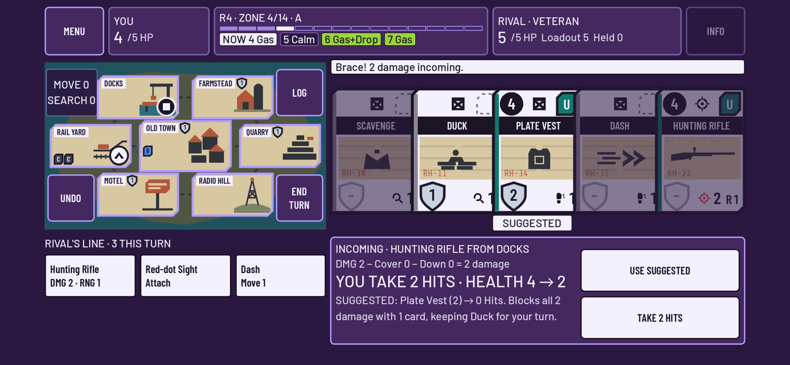
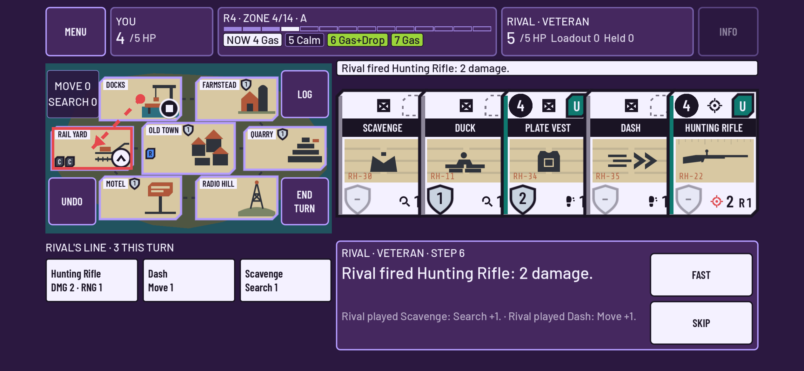

# cz12 · Brace prompt and AI turn playback

Status: in review · Owner: UI/UX Agent · Godot 4.4.1 · Phone landscape first (844x390 pt, touch only)

On the rival's turn your hand is always empty, because you packed it. cz12 uses that space, the
bottom right of the screen and within thumb reach, for the two things that happen to you while the
rival acts: the **Brace prompt** and the **rival's turn playback**.

## 1. Brace prompt (when the AI shoots you)

| Part | What it shows |
|---|---|
| Title | `INCOMING · HUNTING RIFLE FROM DOCKS` (a Frag: `INCOMING · FRAG IN QUARRY`) |
| Sum | `DMG 2 − Cover 0 − Down 0 = 2 damage`: printed damage plus attachments, then the rules engine's Cover and Down |
| Result (large, live) | `YOU TAKE 2 HITS · HEALTH 4 → 2`, `0 HITS · HEALTH 4`, or `YOU TAKE 3 HITS · YOU'RE OUT` |
| Line | Before you choose: `SUGGESTED: Plate Vest (2) → 0 Hits. Blocks all 2 damage with 1 card, keeping Duck for your turn.` After you choose: your choice against the suggestion, and which card comes up into your next hand instead |
| Next hand | The strip above already shows your next hand with Brace shields. Cards that can't brace are dimmed, and a `SUGGESTED` tag sits under each suggested card |
| Buttons | `USE SUGGESTED` (it becomes `CLEAR` once chosen) and the confirm button, `TAKE 2 HITS` or `BRACE · 0 HITS` |

**Two taps:** USE SUGGESTED, then BRACE. **Adjust:** tap next-hand cards, which toggle, then BRACE.
If nothing in your next hand can brace, the panel shows only `TAKE n HITS`, one tap. Every refusal
is explained in words: no Brace value, a Hit, already braced, or not in your next hand.

**The suggestion** (`scripts/match/brace_advisor.gd`) tries every subset of the eligible cards and
picks the one that:
1. lets the fewest Hits through,
2. uses the fewest cards,
3. gives up the least next-turn value (`keep_value`: Search cost, +8 for supply-drop cards, weapon
   damage, attachments, Heal and Pull; a card that is Spent when it braces costs +3),
4. overshoots the damage the least,
5. comes earliest in the next hand (the tie-break).

It reads only your own view and printed card text, so the rival's private cards can't change it.
A test checks this: two states that differ only in the rival's hand and loadout order give the same
suggestion.

**Exposure for the playtest log (cz18):** `MatchController.view()` adds the following to `brace_prompt`:
`hand_size`, `dmg`, `source {card, kind, from, area}`, `suggested` (instance ids) and
`suggestion {cards, card_ids, total, hits, blocked, health_after, eliminated, comes_up, reason}`.
This is the same view that goes out through `EventBus.match_view_changed`. The logger therefore
fills `brace.suggested_used` (true or false) with no logger change; see quirk 3 in
`documentation/production/playtest-log-schema.md`. `brace_suggested(suggestion)` fires when the
step opens, and `brace_preview(cards)` returns the live result of any choice.

## 2. Rival turn playback

- Steps are the engine events that `events_for(human)` filters for you, so the rival's private
  cards are never in them. A step is any event that has words.
- Only steps the rival is involved in are paced: its drop, its turn, its Brace, and your last action
  before it decides. Your own actions answer at once; before cz12 every one of them waited 0.45 s
  per event.
- Step time = Event speed (cz13: normal 0.45 s, fast 0.2 s, instant 0) × weight (shot 1.5, Brace
  and Hits 1.3, move, loot and Pack 1.0, play 0.8, draw and turn 0.6). Waits use wall-clock time
  and last at least one frame.
- **Playback panel:** `RIVAL · VETERAN · STEP 6`, the current step in large text, and the two
  steps before it in smaller text.
- **FAST** plays the rest of this playback at 0.4× the time, and the button reads FAST ON.
  **SKIP** plays the rest at once. Both reset when input opens again.
- After a skipped or Instant rival turn, the toast sums it up in one line: `Rival's turn: played 3
  cards, moved to Rail Yard, looted Crowbar, packed (0 held).` LOG still lists every step.
- **Map marks (placeholder for cz17):** a shot or Frag draws a red dashed tracer with an arrowhead
  from the shooter's area to the target area, and outlines the target. A move or loot outlines the
  area. The marks are static drawings that fade out.
- When the AI braces against your shot, its Brace is shown in the same step text and names the
  cards it used.

### Hooks for game feel (cz17)
- `MatchController.playback_step(step)`: `{index, type, kind, seat, rival, text, event, from, to, duration}`, emitted before the step's wait.
- `hold_playback()` / `release_playback()`: the loop waits on the current step until the effect is done. SKIP ignores holds.
- `busy_changed(is_busy)` and `settled`: await `settled` to know input is open again.
- `playback_finished(summary, steps, skipped)`.
- `TracerLayer.enabled = false` turns off the placeholder marks.

## 3. Tests

| File | Covers |
|---|---|
| `tests/test_brace_prompt.gd` (7) | Suggestion rules, partial block, Spent cost, nothing to brace, lethal, fairness, controller and EventBus exposure, logger `suggested_used` true/false, 2-tap accept, adjust/clear, one-tap TAKE, phone fit (64 px targets, safe area, tags) |
| `tests/test_match_flow_playback.gd` (4) | Step-by-step playback (kinds, order, panel, map marks, pacing weights, busy/settled), FAST/SKIP by touch with summary, Instant summary, game-feel hold, private cards never shown, AI Brace names its cards |
| `tests/test_match_flow_ai.gd` (2) | A full match vs **Rookie** and vs **Veteran** (CzAI.for_level) through the real UI by touch, with pacing on. Every human Brace goes through the panel: accepted suggestions take ≤ 2 taps, alternating with adjusted ones |
| `tests/test_match_flow.gd` | cz11 flow updated for the panel. The flaky pacing check now counts frames per step and checks the whole run against the steps' own durations (it can't fail under load). New: the `no_shooting_round1` switch explained on FIRE and THROW |

The shared touch helpers moved to `tests/test_match_flow_kit.gd`. cz13's
`test_setup_flow.gd` confirms its Brace through the panel (a one-line change).

## 4. Open questions
1. Should the prompt pre-select the suggestion, making it a 1-tap confirm? It currently needs one
   deliberate tap so that `suggested_used` measures a choice.
2. `keep_value` is a simple heuristic based on printed text. Should the suggestion use the AI's loot
   values (CzSim.VALUE) so both agree?
3. During the rival's Brace in your own turn, the steps show only in the toast, because your hand
   is in use. Is that enough?
