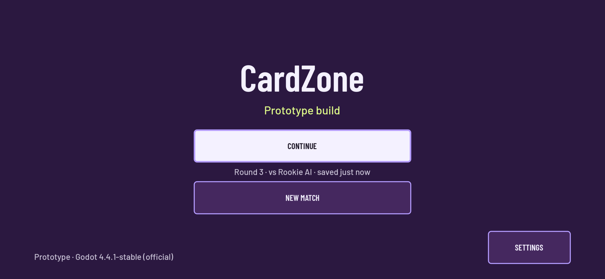
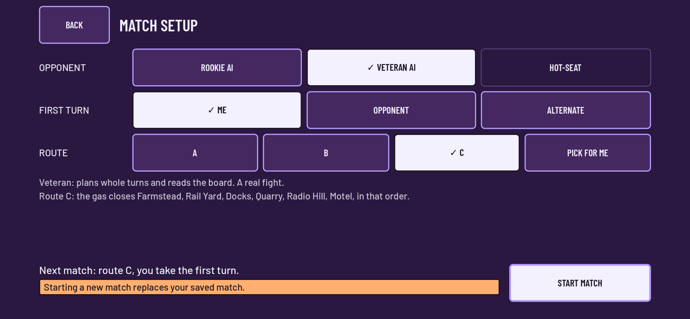
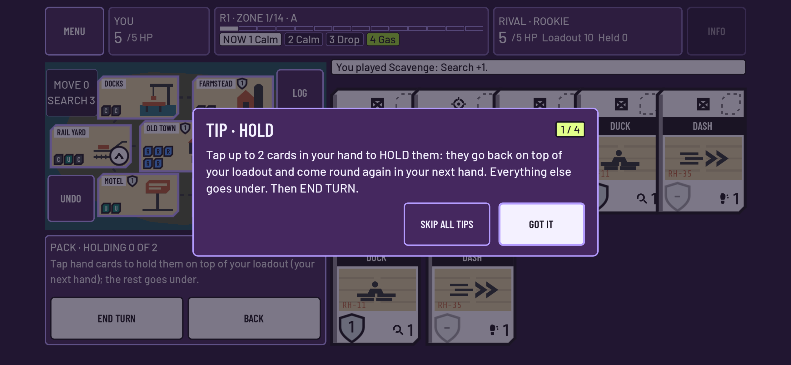

# CardZone shell: Title, setup, pause, end, coach, dev panel (cz13)

*UI/UX Agent · 2026-11-04 · Board task `cz13` · Godot 4.4.1 · status: review*

## Flows (all touch, phone landscape first)
```
Boot -> TITLE --NEW MATCH--> MATCH SETUP --START--> MATCH (drop as cz11) --> END SCREEN
          |                     ^  BACK                 | MENU                   | NEW MATCH (same setup)
          |--CONTINUE (saved)-------------------------> |  PAUSE MENU           | TITLE
          |--SETTINGS (motion, speed, tips)             |   RESUME / RULES / SETTINGS / CONCEDE… / LEAVE TO TITLE (saved)
          '--hold logo 2 s--> DEV PANEL
```

| Screen | What it does |
|---|---|
| **Title** (`scenes/Title.tscn`, `scripts/ui/title.gd`) | **CONTINUE** only when `MatchStore.has_saved_match()`, with a line such as "Round 3 · vs Rookie AI · saved just now". If a save is damaged, from another version or no longer replays, the warning plate shows `MatchStore.status_text()`. With no save, NEW MATCH is the main button. SETTINGS sits bottom right, because the top-right corner belongs to cz18's PLAYTEST button. Holding the logo for 2 s opens the dev panel. "DEV SETTINGS ACTIVE" shows top left. |
| **Match setup** (`scenes/setup/MatchSetup.tscn`, `setup_screen.gd`) | **Opponent:** Rookie AI, Veteran AI, or Hot-seat (disabled: a tap says it isn't in this build; cz14). **First turn:** Me, Opponent or Alternate (S1). **Route:** A, B, C or Pick for me (S2 rotation). Below the rows: what the opponent is like, the route's gas order (read from the Zone deck), and "Next match: route C, you take the first turn." Also a note when a saved match would be replaced. The last choices are remembered. |
| **Match** | The cz11 screen. When a launch request is pending, `MatchShell` (`pause_match_shell.gd`) starts the match and adds the overlays below. |
| **Pause menu** (`pause_menu.gd`) | RESUME · RULES (a scrolling summary) · SETTINGS (reduced motion on/off; event speed normal/fast/instant, applied to the running match; SHOW TIPS AGAIN) · CONCEDE… (asks to confirm) · LEAVE TO TITLE (the save is kept). The match loop waits while the menu is open (`controller.paused`). |
| **End screen** (`scenes/end/EndScreen.tscn`, `end_screen.gd`) | YOU WIN / THE RIVAL WINS / DRAW. A cause tag: ELIMINATION, GAS, FINAL CIRCLE, HARD END or CONCEDE. One sentence on what happened. A stats line: round · turns · health · Hits landed both ways · time. Buttons: NEW MATCH (same setup; Alternate and Pick for me advance) · TITLE · SEE BOARD. After SEE BOARD, MENU shows the result again. |
| **Coach** (`scenes/coach/CoachTip.tscn`, `coach_overlay.gd`, `coach_tips.gd`) | Four tips, each shown the first time its concept comes up. HOLD: the first Pack. BRACE: the first Brace step. DOWN: anyone is Down. ADRENALINE: a Hit in your hand on your turn. One tip shows at a time. The card is modal and the loop waits. Buttons are GOT IT and SKIP ALL TIPS. A tip is remembered when it is shown. Reset it from Settings. Tip texts follow the rules in force (hold limit, Move-only Adrenaline). The coach emits `EventBus.coach_step` for cz18. |
| **Dev panel** (`dev_panel.gd`, `dev_panel_overrides.gd`) | Rows: hand size; F1–F8 (packing rule, hold limit, Adrenaline mode and cap, Down, Bounty heal and final-circle extra, Bounty cover, final-circle hits presets, hard-end card, standard pack, hold looted); the visibility switches; supply-drop cost and ready delay. Each row offers exactly `BalanceConfig.allowed_values` (the final-circle list offers allowed presets). **Hand size 4 also sets supply drop cost 3** (§16.4a), and going back to 5 restores 4. Changes apply to **new matches only** (`RulesData.with_balance(overrides)`). A saved match keeps its own snapshot, and the shipped `balance.tres` is never changed. RESET ALL clears everything. |

## How a match starts
`setup_launch.gd` leaves a request in `Engine` metadata, so it survives the scene change with no new autoload.
- **New match:** `request_new(choices)` -> `begin(ctrl)`. This resolves S1/S2, builds content with the dev overrides, creates `CzAI.for_level(level, seed)` (loaded at run time, falling back to the placeholder with a reason), clears the old save and calls `start_from(MatchState.new_match(...), meta)`.
- **Continue:** `request_resume()` -> `MatchStore.resume()`. The opponent is rebuilt from the saved `meta.ai_level/ai_seed`, then `start_resumed()` runs.
- **Without a request** (cz11 tests, QA fixtures loading Match.tscn directly), the screen keeps its cz11 MENU and end sheets.

Device prefs live in `user://cardzone_prefs.cfg` (`setup_prefs.gd`): setup choices, Alternate and rotation counters, coach seen flags, settings and dev overrides. Under the test runner they use `user://test_shell/`.

## Edits outside my files (all additive)
- `match_controller.gd`: `paused` (the loop waits before the next event or rival action), `hits_landed` and `stats()` for the end screen, and `opponent_kind()` naming a CzAI by its level. cz18 also has additive edits in this file.
- `match_screen.gd`: `shell` var, created when a launch is pending. `start_live()` lets the shell start the match. MENU opens the pause menu and the end opens the end screen when the shell is present.
- `scene_router.gd`: `SCENE_MATCH_SETUP` -> `res://scenes/setup/MatchSetup.tscn`.

## Tests (`tests/test_setup_flow.gd`, `test_title_shell.gd`, `test_coach_pause_end.gd`; helpers in `test_setup_helpers.gd`)
- **Touch-only flow:** Title (no save) -> NEW MATCH -> setup (Hot-seat refused in words; Rookie, Me, route B) -> START -> match with CzAI Rookie -> drop and a whole match by touch, dismissing coach tips with GOT IT -> end screen (winner, cause, stats, buttons >= 44 pt) -> NEW MATCH (same route and AI) -> drop -> MENU -> LEAVE TO TITLE (saved) -> CONTINUE line -> **simulated reload** (launch request and store memory dropped, a fresh MatchStore finds the file) -> CONTINUE resumes the exact fingerprint.
- S1/S2: Alternate swaps P1/P2, Pick for me rotates A, B, C, A. Opponent first makes the human P2, who drops first.
- Title: layout, the CONTINUE line, the damaged-save status, the SETTINGS page. Dev panel: a 1 s hold does nothing and a 2 s hold opens it; every row matches the allowed values; hand 4 sets cost 3; the tag shows; a new match plays the values; CONTINUE keeps the saved rules.
- Coach: due rules; the Hold tip on the first Pack (modal, loop held, SKIP ALL); Down and Adrenaline one at a time; the Brace tip. Pause: rules, settings (speed applied live, reduced motion), concede confirm -> end CONCEDE, SEE BOARD, MENU. The end words are checked for every cause.

## Screenshots (844x390 pt phone @3x with notch)




## Suite
Full suite: **140 passed, 0 failed** (13 new cz13 tests).

## Open questions
1. Event speed defaults to NORMAL (0.45 s per event, 0.35 s before each rival action). Should first-time players start on FAST?
2. Down is coached the first time *anyone* is Down, the rival included. Should it wait until the human is Down?
3. A save that can't be resumed shows its status once, because MatchStore backs the file up and removes it. Is that enough, or should the title keep the warning until the next new match?
