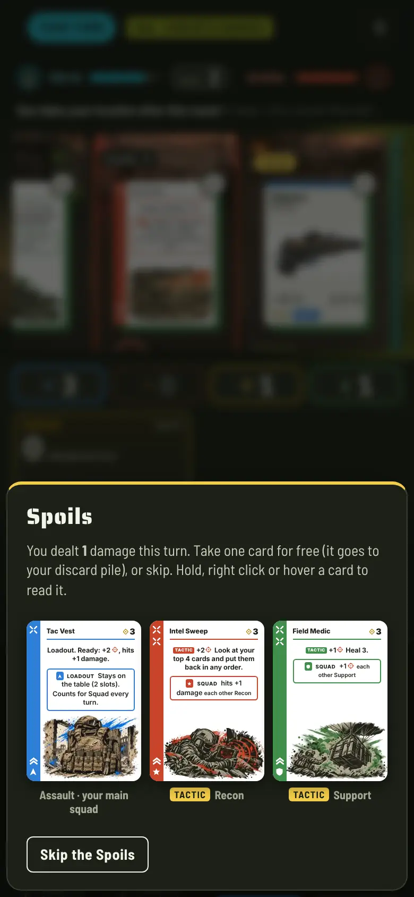
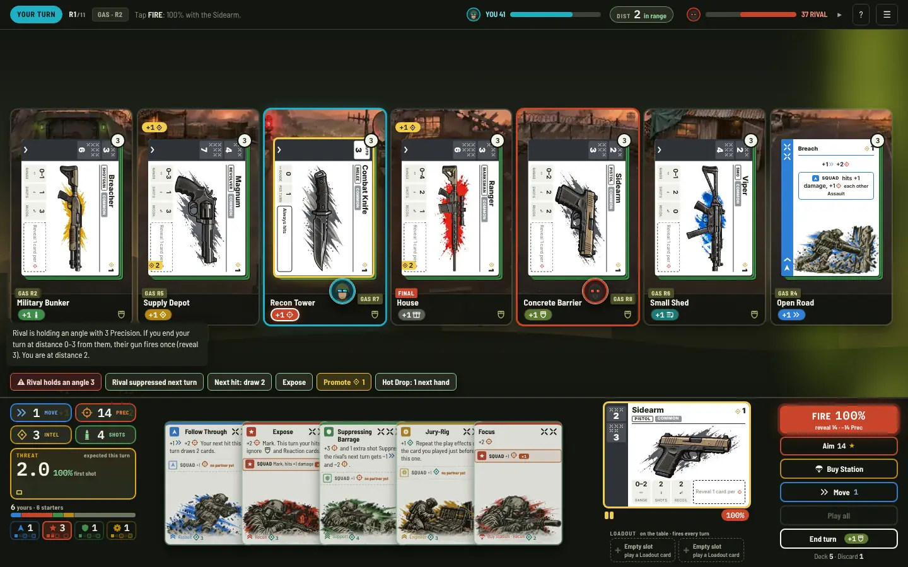
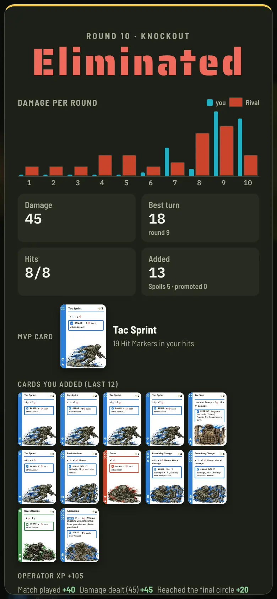
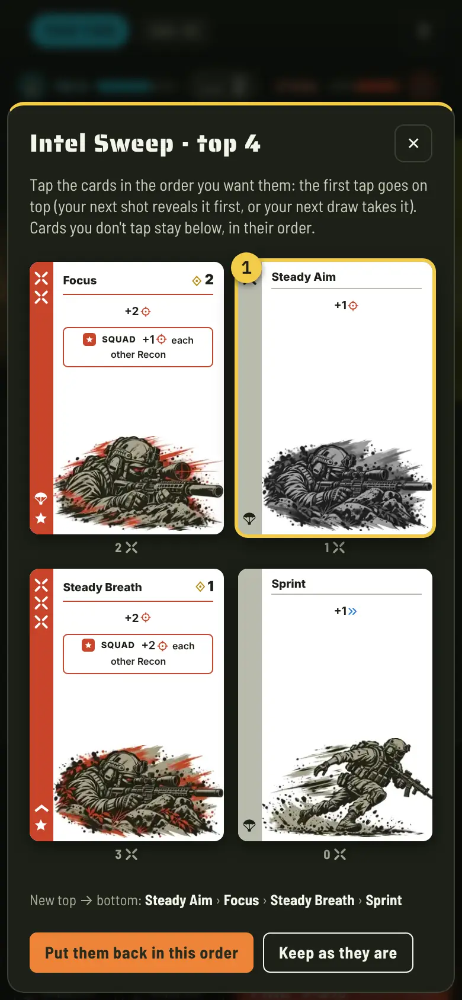

# Warzone Deckbuilder: rules (v7.2, "Squad Tactics" + shot odds + first shot)

*Mechanics Developer · 2026-11-11 · Board task `wb-pkg1` · **The written single source of truth for the rules.***
*Built from `wb-improve-v2.md` with the head's answers: W1 (a) the package (O1 Squad Tactics + O2 Spoils + O3 Field Promotion + O6 Hot Drop delivery + O7 Threat, Deck bar and after-action screen), W2 (b) ranks and unlocks only (O10), W3 (a) Spoils, W4 (a) Health about 55–60 plus a small trim, W5 (a) the 12 Tactics replace 12 cards.*
*v7.1 (board task `wb-odds2`, the head's `wb-odds` answer (a)): shots hit about 65% instead of about 93%. A shot reveals at most 3 cards (extra Precision is Power, +1 damage each); cover and long range raise the Hit Markers a shot needs; Expose, Pierce, Mark, Steady and Intel Sweep bring the odds back; every gun step needs 2 more Hit Markers and deals 2 more damage. Fewer turns now deal damage, so building got three helpers: Spoils also after a turn in which you were hit, Field Promotion is not a buy, the Buy Station Scrap service is free. Results in §13.*
*v7.2 (board task `wb-first-shot`, after the 5-player playtest of v11 in which 4 of 5 testers dealt 0 damage): in rounds 1–3 the **Sidearm has a rookie step** (1 Hit Marker hits for 1, cover and range don't count), so a starter deck can land its first shot. The screen now shows the Hit Markers in your deck next to Threat, and the loot sheet shows each gun's chance with your deck and warns "Your deck can't fire this yet". Results in §14.*
*Text pass (board task `wb-ux-text`, no rule changes): card text, tooltips, log and help use the short wording below ("+1 Movement, +2 Precision.", "Hits +1 damage", one sentence per Tactic). The rules are unchanged.*
*Still in force: the "Warzone Deckbuilder" title and names, the closing circle with a hard end, a single-file build, the print-and-play.*

The engine (`source/project-warbuilder/src/engine.js`) implements exactly these rules; the print-and-play (`src/pnp/gen.js`) and the in-game How to play are generated from the same data. If this page and the code ever disagree, the code is the bug report: fix one of them and its test (`npm test`).

## 1. Overview
Two operators drop into a row of 7 locations that closes from the ends. You start with 10 weak cards and a pistol, loot better cards and guns, build a squad engine, and shoot your rival from 60 Health to 0 before the storm decides it.

## 2. Components and setup
- **Per player:** 10 starters (3 Sprint, 3 Scout, 2 Steady Aim, 2 Recon Run), a Sidearm pistol, 60 Health.
- **Buy Station:** 6 copies of each squad basic (Tac Sprint, Focus, Spare Rounds, Dead Drop), 2 Intel each.
- **Loot:** 76 cards in 3 tiers and 4 squads (12 of them Loadout cards, 24 of them Squad Tactics), 28 loot guns.
- **Map:** 8 location types; 7 are dealt in a fixed row. Each location gets a face-up loot stack of 3 (a Common gun on top while they last; each card is that location's squad 2 times in 3).
- Players start on the 2nd and 6th locations (Operation *Close Drop*: 3rd and 5th) and draw 5. A random player goes first; the lead alternates every round. A coin decides which end of the row closes first.

## 3. Your turn
1. **Ready** (automatic): your Armor drops to 0 (unless you Fortified), your Loadout cards give their effect, then your location's bonus. Suppression from the rival, if any, applies to this turn.
2. **Play cards** in any order to gain Movement, Precision, Intel, extra shots and Armor, and to trigger their other effects.
3. **Move once**: 1 Movement per location. Arriving gives that location's bonus (once per location per turn).
4. **Loot**: up to **2 buys** per turn (+1 per *+1 Buy*): the top card of the stack where you stand (its printed Intel cost), next door (+1 Intel), or a Buy Station basic (2 Intel). **Cycle**: 1 Intel or 1 Movement puts the top of your stack under it. **Buy Station service**: scrap a Sprint for free (v7.1; was 1 Intel; once per turn, not a buy).
5. **Field Promotion** (§5) and **Fire** (§6), in any order with the rest.
6. **End turn**: first **Spoils** if you dealt damage this turn or were hit since your last turn (§4). Then, if you played *Hold the Angle*, up to 3 unspent Precision is saved (§7). Unused Movement becomes Armor (up to 2). Discard your hand and play area (not the Loadout row) and draw 5 (6 at 10 Health or less). Cards from a **Hot Drop** join that new hand.

**Hot Drop (O6):** in rounds 1–3 a card you gain (loot or Buy Station) is set aside and **delivered into your next hand**, on top of the 5 you draw. It can never be revealed by your own shot before you see it. From round 4, gained cards go to your discard pile.

## 4. Spoils (O2)
At the end of a turn in which you dealt damage (any hit: your gun, a Sentry Turret; not a held-angle shot, which happens on the rival's turn) **or if you were hit since your last End turn** (v7.1: the player taking the hits keeps building too), before anything else (once per turn):
- Draw **3 different loot cards** from the loot deck of this phase (tier I in rounds 1–3, II in rounds 4–7, III later; if the deck runs short, the next tier, then the previous). Guns are never offered.
- The **first card is from your main squad** (the squad you own most cards of) when the deck still has one; the others are random.
- **Take 1** to your discard pile, for free, or **skip**. The cards you don't take go back. Nothing else can happen until you choose (the app shows the choice as a sheet; each card can be inspected).

## 5. Field Promotion (O3)
Once per turn, pay **1 Intel** (v7.1: it no longer uses one of your buys): a starter (Sprint, Scout, Steady Aim, Recon Run) in your hand, play area or discard pile **leaves the game**, and a Buy Station basic of **the squad you choose** takes its place, from the Buy Station's stock (6 of each; if a pile is empty you can't promote into it). The basic goes to your hand if the starter was there, otherwise to your discard pile. Promotion is not a purchase for Hot Drop purposes: the card is placed directly.

## 6. Firing
- You carry **one gun**. Buying a gun replaces yours (yours goes under that stack). Every gun fires from distance 0 up to its range.
- **Commit** Precision: reveal one card from the top of your deck per Precision committed, **up to 3 cards** (the aim limit). Count the Hit Markers.
- **Power:** each Precision you commit beyond 3 adds **+1 damage** to every step if the shot hits. (A big Precision turn still pays: as one heavy shot, or as several shots.)
- The shot spends the Precision you committed, then the gun's **Recoil** costs that much more (never below 0).
- **Damage ladder:** reach the first step to hit, the second for a big hit. *Hits +N damage* adds to every step. *Charge* adds +1 more at distance 0.
- **To hit** (v7.1): every step of the ladder needs the printed Hit Markers, **+1 if the target's location has cover** (also at distance 0; *Pierce* and *Expose* ignore cover), **+1 at long range** (distance 2 or more; not the knife), **−1 for Mark** (next shot only) and **−1 per Steady** (every shot this turn). Never below 1. *Intel Sweep* lets you put your best cards on top before you shoot.
- **The chance is always shown before you fire:** the % on FIRE and on every Aim option. Hold (touch) or right click FIRE, or open Aim, to see the need and each modifier (for example "needs 6+: Sidearm 4, rival in cover +1, long range +1").
- **Damage:** **close quarters** (distance 0): Armor is ignored. Otherwise the target's best **Reaction** card in hand, then its **Armor**, reduce the damage. *Expose* switches Reaction cards and Armor off. A hit always deals at least 1. (Cover no longer takes damage off.)
- **First shots (v7.2):** in rounds 1–3 (the Hot Drop rounds) the **Sidearm** has an extra first step, the **rookie step**: **1 Hit Marker hits for 1**. Cover and long range don't raise it (Mark and Steady can't take it below 1); Power and *hits +N damage* add to it as usual. From round 4 the Sidearm has its printed ladder only. The starter deck (4 Hit Markers in 10 cards) reaches it on about half of the turns it can fire.
- **Know before you buy (v7.2):** a shot reveals at most 3 cards, so a gun whose first step your cards can't reach can't hit. The loot sheet shows, for every gun, the chance that a full aim (3 cards from all the cards you own) reaches its first step, before cover and range; under 10% it warns **"Your deck can't fire this yet"**.
- Each gun fires up to its **Shots** per turn, plus extra shots. **Combat Knife**: distance 0 only, always hits for 5 (cover does not stop it).
- Revealed cards go to your discard pile. When your deck is empty, shuffle your discard pile into a new deck.

### Guns (v7.1: every step +2 Hit Markers and +2 damage over v7)
The second steps of the Ranger (10+) and the Longbow (11+) are out of reach of 3 cards on their own (at most 9 Hit Markers): a headshot needs Mark or Steady, which is Recon's job.
Rarity mods are unchanged (Hollow Points +1 damage, Extended Mag +1 shot, Compensator −1 Recoil, Red Dot −1 Hit Marker on every step).

| Gun (Common) | Class | Range | Ladder (Hit Markers → damage) | Shots | Recoil |
|---|---|---|---|---|---|
| Sidearm | Pistol | 0–2 | (rounds 1–3: 1+ → 1), 5+ → 4, 7+ → 5 | 2 | 2 |
| Magnum | Revolver | 0–3 | 6+ → 6, 9+ → 9 | 1 | 3 |
| Combat Knife | Melee | 0 | always → 5 | 1 | 0 |
| Viper | SMG | 0–1 | 5+ → 4, 8+ → 6 | 2 | 0 |
| Breacher | Shotgun | 0–1 | 5+ → 5, 9+ → 8 | 1 | 3 |
| Raider | Burst Rifle | 0–2 | 5+ → 4, 9+ → 6 | 2 | 0 |
| Sapper | Launcher | 0–3 | 6+ → 6, 9+ → 9 | 1 | 3 |
| Sentinel | Assault Rifle | 0–3 | 6+ → 5, 8+ → 7 | 2 | 1 |
| Bastion | LMG | 0–3 | 6+ → 5, 9+ → 7 | 3 | 0 |
| Ranger | Marksman Rifle | 0–4 | 6+ → 5, 10+ → 8 | 2 | 1 |
| Longbow | Sniper | 0–5 | 6+ → 6, 11+ → 10 | 1 | 2 |

## 7. Squads, Rally, Loadout and Squad Tactics
- **Squad line:** pays once for **each other card of its squad** in play this turn (Loadout counts), up to ×3, in any order.
- **Rally:** with 3 and with 5 cards of one squad in play you also get that squad's bonus, once per turn each. Assault 3: hits +1 damage, +2 Precision, Pierce; 5: hits +1 damage, +2 Precision. **Recon 3: Mark; 5: Mark, hits +1 damage, +2 Precision** (v7.1: Rally 3 lost its +1 damage, because Mark is worth more when shots are harder). Support 3: +2 Precision, +1 extra shot, Steady; 5: +3 Precision, +1 extra shot, Steady ×2 (Steady: −1 Hit Marker needed on every shot this turn). Engineer 3: +1 Intel, +1 Precision; 5: draw 1, +1 Buy (v7.1: +1 Precision and +1 Buy).
- **Loadout** cards go to your Loadout row (2 slots): they give their effect when deployed and at every Ready, and count for Squad and Rally. With both slots full, a new one replaces a slot (the old card to your discard) or is used once.
- **Keywords:** Mark (next shot needs 1 fewer Hit Marker), Steady (every shot this turn needs 1 fewer; v7.1: no free card), Pierce (ignore cover), Hits +N damage (this turn), Scrap (remove a card in hand, play area or discard pile from the game; never below 7 cards), +1 Buy (one more buy), Reaction (cuts damage when you are hit with it in hand).

### Squad Tactics (O1): the rules of the 12 new verbs
| Tactic | Squad | Rule |
|---|---|---|
| **Charge** | Assault | Hits at distance 0: +1 damage this turn. |
| **Follow Through** | Assault | Next hit this turn: draw 2 right away. You may play them and keep firing. |
| **Adrenaline** | Assault | When you are hit, one Adrenaline returns from your discard pile to your hand (play it next turn). |
| **Intel Sweep** | Recon | Reorder your top 4 cards (shots reveal from the top). Until you arrange them they stay as they were; if your deck changes first, the Sweep is over. |
| **Expose** | Recon | Mark. This turn ignore cover, Armor and Reactions (v7.1: cover too). |
| **Hold the Angle** | Recon | End turn: hold up to 3 unspent Precision (v7.1: the aim limit). If the rival **ends their next turn** in your gun's range, your gun fires once with it: reveal that many cards and use the gun's printed ladder (no Recoil, no Mark, no Steady, no damage bonuses; cover and long range raise the need; Reactions and Armor apply). Otherwise it is lost at your Ready. |
| **Fortify** | Support | Keep your Armor at your next Ready (max 6) instead of dropping to 0. |
| **Field Medic** | Support | Heal 3, never above your starting Health. |
| **Suppressing Barrage** | Support | Suppress: on the rival's next turn the first 1 Movement and 2 Precision they gain (Loadout, location, cards) are lost. |
| **Jury-Rig** | Engineer | Repeat the play line of your previous card this turn (not a Squad line, Loadout effect or Jury-Rig). Played first: nothing to repeat. |
| **Sentry Turret** | Engineer (Loadout) | When deployed and every Ready, if the rival is 0–3 away, reveal 1: 1 Hit Marker hits for 2 (cover and long range raise the need; Reactions and Armor apply). Its damage counts for Spoils. |
| **Contraband Run** | Engineer | Buy from any stack this turn, at printed cost (no next-door cost). |

## 8. The circle and the end
- At the end of rounds 2, 4, 5, 6, 7 and 8 one end location closes (alternating ends; the schedule is public): 7 → 1 location, the **final circle**, after round 8. Its loot is lost.
- Caught outside at round end: 3 damage +1 per extra location deep (Operation *Scorched Earth*: +1), then you are moved to the nearest safe location.
- In the final circle the storm hits both operators at each round end for 3, then 4, 5, 6.
- Every round end each safe stack gets 1 fresh card on top (tier by phase); a stack over 3 loses its bottom card. **Supply crates** after rounds 2 and 4 (Operation *Supply Run*: and 6): 3 tier III items, a gun first, on top of the middle stack.
- **Winning:** bring your rival to 0 Health. If both fall at once, the higher Health wins (equal: draw). **Hard end** after round 11: the most Health wins.

## 9. Operator rank and unlocks (O10, digital only)
Saved on this device (`localStorage` key `wb-operator-v1`; every read and write is guarded, and the game works without it). XP after every match vs the AI: **40** for playing, **+60** for a win (+30 for a draw), **+1 per damage dealt** (up to 80), **+20** for reaching the final circle. Unlocks add **variety, never power**:

| Rank | XP | Unlocks |
|---|---|---|
| Recruit | 0 | the full card pool, always |
| Private | 150 | **Daily Drop**: one seeded match per day, the same for everyone (no Operations) |
| Corporal | 350 | Operation **Close Drop**: both operators start 2 locations apart |
| Sergeant | 650 | Operation **Supply Run**: a third supply crate after round 6 |
| Staff Sergeant | 1,000 | Operation **Scorched Earth**: the gas deals 1 more damage |
| Lieutenant | 1,500 | silver insignia |
| Captain | 2,200 | gold insignia |

Operations apply to **both** operators, so they change the drop, not the odds. At the table you can play any Operation by agreement.

## 10. What the screen shows (O7)
- **Threat** (replaces the Firepower sum): the damage you can expect from the rest of this turn if you play your hand and shoot as the planner suggests, with the first shot's odds. Between turns: the damage you dealt, with a per-turn sparkline.
- **Hit Markers (v7.2):** next to Threat, the Hit Markers in your deck (total, per card) and your gun's chance with a full aim; it turns red when your deck can't reach your gun's first step. FIRE's hint says so too ("Your deck can't hit with the Magnum yet").
- **Deck bar:** starters against the cards you added, coloured by squad and patterned (stripes, dots, bars), and the squad counters carry a label (AST, REC, SUP, ENG): squads are never told apart by colour alone.
- **Tactical chips:** every Tactic in play, yours and your rival's (red ⚠ when it can hurt you: a held angle, a Suppression). Each chip, card, gun and location explains itself on **long press (touch), right click or hover (mouse)**; the zoom of a card, gun or location adds one plain line: what it gives you now (Squad ×N, % to hit, when the gas takes it).
- **Next step and the rival's turn (wb-ux-text):** one line says what to do now; after the rival's turn it first says what they did (cards played, move, buys, shots, the damage you took).
- **After-action report:** damage per round for both players, your best turn and its round, your MVP card (most Hit Markers in your hits), the cards you added, XP and rank.

Screenshots (from `qa/tools/smoke_pkg.js`, headless Chromium, the built page):

| | |
|---|---|
|  |  |
| Spoils after a damaging turn (phone). | Tactical chips; right click explains the rival's held angle (desktop). |
|  |  |
| After-action report (phone). | Intel Sweep: tap the new order (phone). |

## 11. Card list (v7)
Starters: Sprint (+1 Movement, 0 Hit Markers), Scout (+1 Intel, 0), Steady Aim (+1 Precision, 1), Recon Run (+1 Movement, +1 Intel, 1). Buy Station basics (2 Intel, Squad line in brackets): Tac Sprint +1 Movement +2 Precision, 1 HM (+1 Precision); Focus +2 Precision, 2 HM (+1 Precision); Spare Rounds +2 Precision +1 extra shot, 1 HM (+1 Precision); **Dead Drop** +2 Intel, 1 HM (**+1 Buy**, was +1 Intel).

**Replaced by the 12 Tactics (W5):** Flank → Charge, Run and Gun → Follow Through, Blitz → Adrenaline, Heartbeat Sensor → Intel Sweep, Thermal Optic → Expose, Headhunter → Hold the Angle, Steady Grip → Fortify, Munitions Drop → Field Medic, Covering Fire → Suppressing Barrage, Field Kit → Jury-Rig, Munitions Box → Sentry Turret, Black Market → Contraband Run. Same copies, same tiers (Sentry Turret: one tier II and one tier III copy), same print-and-play size; each keeps the art of the card it replaced.

**Trimmed (W4):** every gun ladder +1 Hit Marker; Ammo Box (Steady instead of an extra shot), Bandolier and Resupply (no extra shot), Field Pack (+1 Precision and Steady). **Retuned for balance:** Spotter Scope's Squad line (Mark, hits +1 damage), Recon Rally, Dead Drop's Squad line. **v7.1 (shot odds):** every gun step +2 Hit Markers and +2 damage, Combat Knife 5, Breach, Slide Cancel, Hip Fire, Rush the Door, Charge and Follow Through 3 Hit Markers (were 2), Hip Fire's and Suppressing Fire's Squad lines give Steady, Recon Rally 3 is Mark only, Engineer Rally +1 Precision (3) and +1 Buy (5), Hold the Angle saves up to 3.

Loot cards by squad (generated from the engine):

### Assault

| Card | Tier | Intel | Hit Markers | Copies | Play | Squad line (once per other Assault card in play, up to ×3) |
|---|---|---|---|---|---|---|
| Breach | I | 1 | **3** | 2 | +1 Movement, +2 Precision. | Hits +1 damage, +1 Precision |
| Slide Cancel | I | 1 | **3** | 2 | +2 Movement, +1 Precision. Scrap 1. | Draw 1, +2 Precision |
| Hip Fire | I | 2 | **3** | 2 | +1 Movement, +2 Precision. | +2 Precision, Steady (was +3 Precision) |
| Rush the Door | II | 3 | **3** | 2 | +1 Movement, +3 Precision. Pierce. | Hits +1 damage, +2 Precision |
| Charge · **Tactic** | II | 3 | **3** | 2 | +2 Movement, +1 Precision. Hits at distance 0: +1 damage this turn. | +1 Precision |
| Follow Through · **Tactic** | II | 3 | **3** | 2 | +1 Movement, +2 Precision. Next hit this turn: draw 2. | +1 Precision |
| Adrenaline · **Tactic** | III | 4 | 3 | 2 | +1 Movement, +3 Precision. When you are hit, it returns from discard to hand. | +1 Precision |
| Breaching Charge | III | 4 | 3 | 2 | +1 Movement, +3 Precision. Pierce. Hits +1 damage. | Hits +1 damage, +1 extra shot, Steady |
| Tac Vest | I/II/II | 3 | 1 | 3 | Loadout. Ready: +2 Precision, Hits +1 damage. | (Loadout: counts for Squad and Rally) |

### Recon

| Card | Tier | Intel | Hit Markers | Copies | Play | Squad line (once per other Recon card in play, up to ×3) |
|---|---|---|---|---|---|---|
| Mark Target | I | 1 | 2 | 2 | +2 Precision. | Mark, +1 Precision |
| Steady Breath | I | 1 | 3 | 2 | +2 Precision. | +2 Precision |
| Snapshot | I | 2 | 2 | 2 | +2 Precision, +1 Intel. | +2 Intel, +1 Precision |
| Intel Sweep · **Tactic** | II | 3 | 2 | 2 | +2 Precision. Reorder your top 4 cards. | Hits +1 damage |
| Spotter Scope | II | 3 | 3 | 2 | +3 Precision. | Mark, Hits +1 damage |
| Expose · **Tactic** | II | 3 | 2 | 2 | +2 Precision. Mark. This turn ignore cover, Armor and Reactions. | Mark, Hits +1 damage |
| UAV | III | 4 | 3 | 2 | +3 Precision, +1 Intel. Pierce. | Draw 1, Mark, +1 Precision |
| Hold the Angle · **Tactic** | III | 4 | 3 | 2 | +3 Precision. End turn: hold up to 3 Precision; fire it if the rival ends in range. | Hits +1 damage |
| Recon Post | I/II/II | 3 | 1 | 3 | Loadout. Ready: +2 Precision. | (Loadout: counts for Squad and Rally) |

### Support

| Card | Tier | Intel | Hit Markers | Copies | Play | Squad line (once per other Support card in play, up to ×3) |
|---|---|---|---|---|---|---|
| Ammo Box | I | 2 | 2 | 2 | +2 Precision. Steady. Scrap 1. | +3 Precision |
| Suppressing Fire | I | 2 | 2 | 2 | +2 Precision, +1 Armor. | +2 Precision, Steady (was +1 Armor) |
| Bandolier | I | 2 | 2 | 2 | +2 Precision, +1 Armor. Steady. | +3 Precision |
| Fortify · **Tactic** | II | 3 | 2 | 2 | +2 Precision, +2 Armor. Keep your Armor at your next Ready (max 6). | +1 Armor |
| Resupply | II | 3 | 2 | 2 | +1 Precision, +1 Intel. Draw 1. | Steady, +2 Precision |
| Field Medic · **Tactic** | II | 3 | 2 | 2 | +1 Precision. Heal 3. | +1 Precision |
| Overwatch | III | 5 | 3 | 2 | +4 Precision, +1 extra shot, +2 Armor. | +2 Precision, +1 Armor |
| Suppressing Barrage · **Tactic** | III | 4 | 3 | 2 | +3 Precision, +1 extra shot. Suppress: rival's next turn −1 Movement, −2 Precision. | +1 Precision |
| Field Pack | I/II/II | 3 | 1 | 3 | Loadout. Ready: +1 Precision, Steady. | (Loadout: counts for Squad and Rally) |

### Engineer

| Card | Tier | Intel | Hit Markers | Copies | Play | Squad line (once per other Engineer card in play, up to ×3) |
|---|---|---|---|---|---|---|
| Scrounge | I | 2 | 1 | 2 | +1 Precision, +2 Intel. Scrap 1. | +2 Intel |
| Deployable Cover | I | 2 | 1 | 2 | +1 Precision, +2 Intel. | +2 Intel |
| Ping | I | 1 | 1 | 2 | +1 Precision, +1 Intel. 1 free cycle. | Draw 1, +1 Intel |
| Jury-Rig · **Tactic** | II | 3 | 2 | 2 | +1 Intel. Repeat the play line of your previous card. | +1 Intel |
| Sentry Turret · **Tactic** | II/III | 3 | 1 | 2 | Loadout. Ready: if the rival is 0–3 away, reveal 1: 1 Hit Marker hits for 2. | (Loadout: counts for Squad and Rally) |
| Salvage | II | 3 | 2 | 2 | +1 Precision, +2 Intel. Scrap 1. 2 free cycles. | +2 Intel, +1 Buy |
| Field Workshop | III | 4 | 2 | 2 | +2 Precision, +2 Intel. Draw 1. Scrap 2. | +2 Precision, Draw 1 |
| Contraband Run · **Tactic** | III | 4 | 2 | 2 | +1 Precision, +3 Intel. Buy from any stack this turn (printed cost). | +1 Intel |
| Bounty Contract | I/II/II | 3 | 1 | 3 | Loadout. Ready: +1 Intel, +1 Precision. | (Loadout: counts for Squad and Rally) |

## 12. Validation of v7 (acceptance gates of `wb-improve-v2.md` §3; v7.1 is in §13)
2,000 seeded AI matches per row (seeds 1…2000, seats alternate), the engine's own AI (`WD.aiTurn`): it plays Tactics (Jury-Rig after its best card, Follow Through draws played at once, Sweeps arranged with the most Hit Markers on top, held angles avoided when moving), takes Spoils (main-squad lean when combo-aware), and promotes starters with the Intel left after buying. "Before" is the v6 engine as of commit `dc9fdbe` (`git show dc9fdbe:projects/warbuilder/source/project-warbuilder/src/engine.js`) through the same tool; its build edge comes from `ai_sim_v2.js` (that engine has no random-buyer mode), same seeds.

| Gate | Target | Before (v6) | After (v7) | Met |
|---|---|---|---|---|
| Build edge: aware AI vs random buyer | ≥ 85% | 85.6% | **89.5%** | Yes |
| Synergy edge: combo-aware vs combo-blind AI | ≥ 55% | 59.2% | **63.5%** | Yes |
| Rounds per match (aware mirror) | 8–9 | 8.64 | **8.46** | Yes |
| Matches that reach the final circle | ≥ 50% | 66% | **55%** | Yes |
| Your own cards in hand, round 6 | ≥ 0.45 | 0.34 | **0.46** | Yes |
| Your own cards in hand, round 8 | (≥ 0.50 wanted) | 0.43 | **0.61** | Yes |
| Win rate by main squad (aware mirror) | each 45–60% | Assault 44.8%, Engineer 57.9%, Recon 48.7%, Support 52.7% | Assault 51.4%, Engineer 47.6%, Recon 49.5%, Support 49.4% | Yes (before: No) |
| Cards gained per match | (more building) | 7.3 | 12.2 (Spoils 4.4, promotions 1.4) | |
| Starters left at the end | (visible change) | 7.2 | 5.8 | |
| Damage per turn, rounds 2 / 4 / 6 / 8 | (a curve you can feel) | 1.1 / 2.2 / 4.8 / 8.0 | 0.5 / 3.2 / 8.7 / 14.1 | |
| Hit rate of the shots the AI takes | head's 60–70% | 87% | 93.5% | No (both) |
| Errors, stuck matches | 0 | 0 | 0 | Yes |

Tactic plays per match (both players, mirror): Fortify 0.67, Follow Through 0.64, Expose 0.59, Charge 0.51, Field Medic 0.50, Intel Sweep 0.35, Jury-Rig 0.23, Sentry Turret 0.11, Suppressing Barrage 0.07, Adrenaline 0.07, Contraband Run 0.04, Hold the Angle 0.03 (tier III cards arrive late).

**Notes.**
- **Pacing:** Health 60 alone was not enough (7.7 rounds, final circle 27%): the package adds about 5 cards per player. The trim that brought it back: every gun step +1 Hit Marker, Support's 4 cheapest extra shots removed, and Field Promotion uses a buy. Raising Promotion to 2 Intel also worked (8.65 rounds) but dropped own cards in hand at round 6 to 0.44.
- **Skill:** Spoils and Promotion help a combo-blind player too (the design doc measured 51% for O2 + O3). Two rules keep combos worth playing: the first Spoils card is from your main squad, and the combo-aware AI promotes into the basic that fits its deck.
- **Balance:** losing Heartbeat Sensor, Thermal Optic and Headhunter took Recon to 33–36%; Recon now hits harder (Rally and three Squad lines give *hits +1 damage*) and is at 49.5%. Engineer lost value when promotions started to cost a buy; Dead Drop's Squad line is now +1 Buy (47.6%, the smallest sample: 269 of 4,000 players).
- **Not met, as before:** the shots the AI chooses to take hit 93.5% of the time (87% before). The AI waits for good odds; the planner's shown odds on a typical first shot are lower. Lowering this needs a separate decision (it was open in `engine-synergy-spec.md` §8 too).
- **Early rounds:** damage in round 2 dropped (1.1 → 0.5) because of the gun trim; from round 4 the curve is steeper than before. Watch this in the human playtest.
- **Not measurable by the sim:** whether a buy changes how you play (the 3-person playtest gate) and how the new readouts feel.

**Reproduce** (from the repo root):
```bash
node projects/warbuilder/qa/tools/ai_sim_pkg.js 2000                       # the gate table (after); add --engine=<old engine.js> for before
node projects/warbuilder/qa/tools/smoke_pkg.js                             # 2 full matches in the built page (phone + desktop) + staged screens
cd projects/warbuilder/source/project-warbuilder && npm test && npm run build
```

## 13. v7.1 shot odds (`wb-odds2`): validation
Same tools and seeds as §12 (2,000 AI matches per row, seeds 1…2000, seats alternate). "Before" is v7 (commit `e864633`) through `--engine=`; ranged hit rate, first player and gas come from `ai_sim.js` (aware mirror).

| Metric | Target | Before (v7) | After (v7.1) | Met |
|---|---|---|---|---|
| Hit rate of the shots taken (knife included) | head's 60–70% | 93.5% | **64.7%** | Yes (before: No) |
| Hit rate of gun shots (knife left out) | | 92.6% | 57.4% | |
| Build edge: aware AI vs random buyer | ≥ 85% | 89.5% | **86.0%** | Yes |
| Synergy edge: combo-aware vs combo-blind AI | ≥ 55% | 63.5% | **62.5%** | Yes |
| Rounds per match (aware mirror) | 8–9 | 8.46 | **8.53** | Yes |
| Matches that reach the final circle | ≥ 50% (about 55%) | 55% | **55%** | Yes |
| Your own cards in hand, round 6 / 8 | ≥ 0.45 / (≥ 0.50) | 0.46 / 0.61 | **0.51 / 0.63** | Yes |
| Win rate by main squad (aware mirror) | each 45–60% | A 51.4, E 47.6, R 49.5, S 49.4 | A 48.5, E 56.9, R 49.1, S 51.9 | Yes |
| Damage per turn, rounds 2 / 3 / 4 / 5 / 6 / 7 / 8 / 9 | about the same; round 2 not lower | 0.5 / 1.1 / 3.2 / 5.3 / 8.7 / 11.8 / 14.1 / 15.2 | 0.8 / 1.2 / 3.3 / 4.4 / 6.7 / 9.9 / 12.1 / 13.8 | |
| First-player win rate | 45–55% | 51.8% | 52.3% | Yes |
| Gas and storm share of damage | (report) | 5.9% | 9.2% | |
| Shots per match / big hits (second step) | (report) | 19.9 / 47% | 12.2 / 12% | |
| Spoils / promotions per player | (report) | 4.4 / 1.4 | 3.1 / 2.8 | |
| Errors, stuck matches, invariant failures | 0 | 0 | 0 | Yes |

**What it took, and why** (each lever was simulated on its own first):
- **Cover and range alone did nothing** (93–94%): the AI just commits more Precision, and the sum of 6+ revealed cards is almost never short. Raising every ladder by 3 Hit Markers did nothing either. A shot's odds can only be "about 65%" if the number of cards per shot is bounded, so a shot reveals **at most 3 cards**; extra Precision is not wasted, it is **Power** (+1 damage each).
- With 3 cards, **Steady** as a free extra card made Support far too strong; as "−1 Hit Marker needed" it is simple and in line with Mark.
- **Close quarters** keeps "no Armor" but no longer ignores cover: otherwise every fight moved to distance 0 and the odds never dropped.
- **Ladders +2 Hit Markers and +2 damage** set the odds and keep the damage curve; round 2 damage is up (0.5 → 0.8), rounds 5–8 are 1–2 lower, round 9 to the end is the same, and the match length and final circle are unchanged.
- **Fewer turns deal damage** (62% → 42% of turns have a shot), so Spoils fell from 4.4 to 1.6 per player and the build gates failed (build edge 80%, own cards 0.40). Spoils after being hit, Field Promotion not using a buy and a free Scrap service bring them back. Field Promotion without Intel was tried and dropped: Engineer fell to 39–44%.
- **Squads:** higher needs favour decks with more Hit Markers and need cuts. Six Assault cards went to 3 Hit Markers and Hip Fire's Squad line gives Steady (Assault was 38–41% without them); Suppressing Fire's Squad line gives Steady (Support 44%); Recon Rally 3 lost its +1 damage; Engineer Rally gained +1 Precision and +1 Buy. The AI now values Hit Markers, Mark, Steady and Pierce more, because they set the odds.
- **Watch in the playtest:** the starter deck (mostly 0–1 Hit Marker cards) can't hit with the Sidearm (5+) until it has bought a few cards; Ranger and Longbow headshots need Mark or Steady; Tactics are played a little less (Fortify 0.67 → 0.22, Field Medic 0.50 → 0.16 per match).

**Reproduce:** `git show e864633:projects/warbuilder/source/project-warbuilder/src/engine.js > /tmp/v7.js`, then `node projects/warbuilder/qa/tools/ai_sim_pkg.js 2000 --engine=/tmp/v7.js` (before) and `node projects/warbuilder/qa/tools/ai_sim_pkg.js 2000` (after); `node projects/warbuilder/qa/tools/ai_sim.js 2000` for the ranged hit rate.

## 14. v7.2 first shot (`wb-first-shot`): validation
The 5-player playtest of v11 (`wb-playtest`): FIRE showed under 1% for most of every match and 4 of 5 testers dealt 0 damage. The sims reached the 65% hit target because the AI builds for Hit Markers; a new player doesn't know to, and nothing warned them.

**The new-player bot** (`aiMode: 'naive'`, sim only, `WD.aiTurn`): plays every card, walks toward the rival until in range (and out of closing gas), buys the biggest gun it can afford and then the priciest cards, takes the first Spoils card, never promotes, scraps or cycles, and fires whenever FIRE shows more than 0% (with FIRE's commit). `naive+warn` is the same player when it reads the loot sheet and skips guns marked "Your deck can't fire this yet". A **live turn** is one on which FIRE could be pressed (a gun in range and Precision to aim, or the knife at distance 0).

2,000 seeded matches per row (seeds 1…2000, seats alternate), `node projects/warbuilder/qa/tools/ai_sim_pkg.js 2000`; "Before" is v7.1 (`--set=rookieRounds:0`; the loot warning did not exist, so the before player is the one who ignores it).

| New player vs the AI | Before (v7.1) | After: ignores the warning | After: reads the warning |
|---|---|---|---|
| Live turns with a hit, round 1 / 2 / 3 | 0% / 15% / 13% | 0% / 20% / 22% | 48% / 84% / **89%** |
| Live turns with a hit, rounds 3–11 | 16% | 18% | 49% |
| Hit rate of the shots it takes | 49% | 50% | 66% |
| Matches in which it deals damage | 45% | 51% | **98%** |
| Damage per turn, rounds 2 / 3 / 4 / 8 | 0.8 / 0.8 / 0.8 / 1.8 | 0.9 / 0.9 / 0.8 / 1.9 | 3.0 / 3.7 / 2.6 / 4.7 |
| Shots per match | 3.0 | 3.2 | 7.0 |
| Wins vs the AI | 6.6% | 6.5% | 15.2% |

| Gate (§12, §13) | Target | Before (v7.1) | After (v7.2) | Met |
|---|---|---|---|---|
| Hit rate of shots taken (aware mirror) | 60–70% | 64.7% | **64.8%** | Yes |
| Build edge: aware AI vs random buyer | ≥ 85% | 86.0% | **85.6%** | Yes |
| Synergy edge: combo-aware vs combo-blind | ≥ 55% | 62.5% | **62.4%** | Yes |
| Rounds per match / final circle | 8–9 / ≥ 50% | 8.53 / 55% | **8.52 / 55%** | Yes |
| Own cards in hand, round 6 / 8 | ≥ 0.45 / (≥ 0.50) | 0.51 / 0.63 | **0.52 / 0.63** | Yes |
| Win rate by main squad (mirror) | each 45–60% | A 48.5, E 56.9, R 49.1, S 51.9 | A 48.4, E 57.1, R 49.2, S 52.1 | Yes |
| New player (reads the warning): live turns with a hit, round 3 | ≥ 40% | (13%) | **89%** | Yes |
| New player (reads the warning): matches with damage | > 50% | (45%) | **98%** | Yes |

**What it took, and why** (about 30 variants simulated, 300–2,000 games each):
- The starter deck can't reach any printed step: 4 Hit Markers in 10 cards and about 1 Precision per hand, so a turn reveals 1–2 cards. Only a step that needs **1 Hit Marker, fixed** (cover is +1 on 5 of 8 locations) makes a starter hand hit on about half its live turns (46% at distance 1 with random cover, 48% of the bot's round-1 live turns).
- Every rule that also helps the player who keeps buying guns it can't fire helped the AI more: easier Common guns, more Hit Markers or Steady on starters, a permanent rookie step. They pushed the AI's hit rate to 70–89%, shortened matches to 6.4–7.8 rounds, or dropped the build edge to 77–83%. Even the rookie step at 2 damage (84.6%) or through round 4 (84.5%) missed the build edge. Rounds 1–3 at 1 damage keep every gate.
- So the fix is mostly information: the bot that ignores the warning still trades its Sidearm for a gun its deck can't fire and lands a hit on only 22% of its live turns in round 3 (13% before). The same bot reading the loot sheet keeps a gun it can fire, then lands hits on 89% of its live turns in round 3 and deals damage in 98% of matches. The UI (Hit Markers next to Threat, the % and warning on every gun, FIRE's hint) is how a person gets that information.
- **Watch in the next playtest:** after round 3 the Sidearm goes back to 5+; the warning player still hits on about half its live turns (49%), but a player who ignores every readout is still stuck. If that shows up, the next lever is teaching (a guided first match), not the odds.

**Reproduce:** `node projects/warbuilder/qa/tools/ai_sim_pkg.js 2000` (after) and `node projects/warbuilder/qa/tools/ai_sim_pkg.js 2000 --set=rookieRounds:0` (before; v7.1 rules with the same bots).
