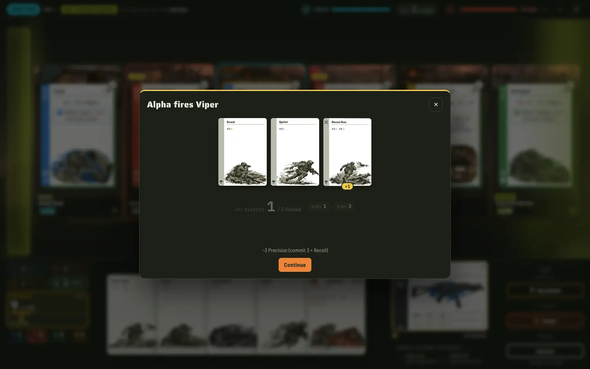
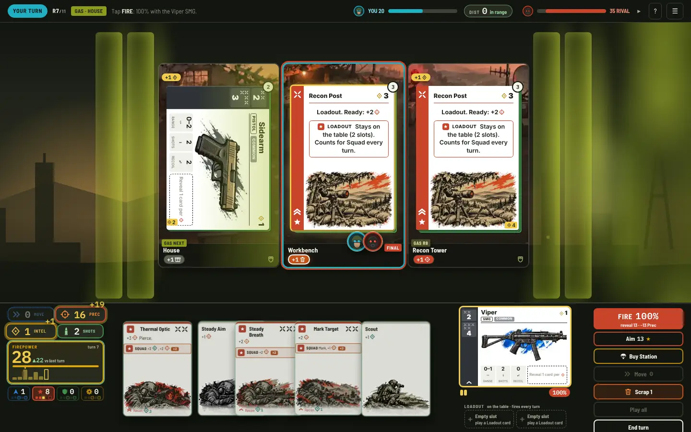
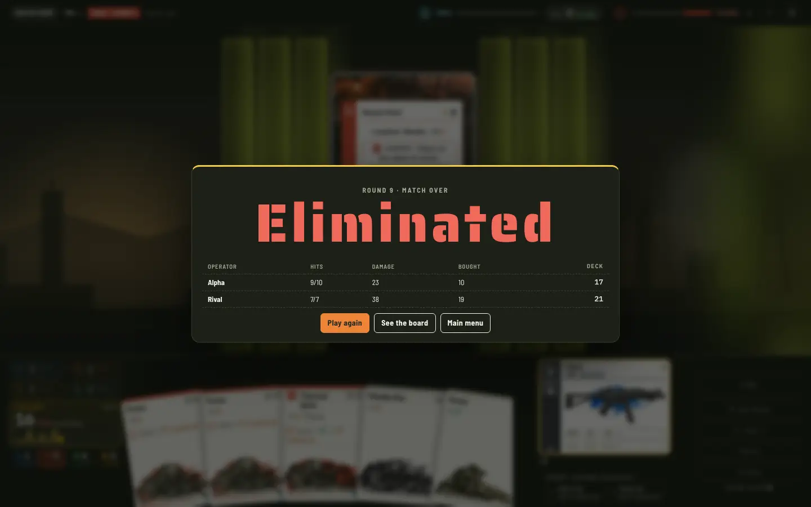
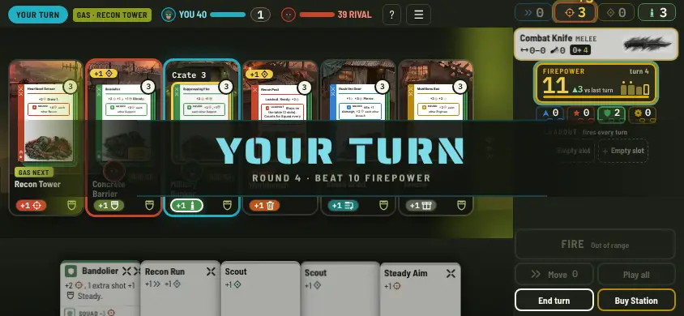

# Warbuilder: deckbuilding satisfaction and progression (diagnosis + improvement options)

*Sr Game Designer · 2026-11-11 · Board task `wb-fix2` · Status: **proposal, awaiting the head's choice. Nothing here is built yet.***
*Inputs: the head's request ("revert the push-your-luck changes; try the game and give improvement possibilities. I like the concept, but the gameplay doesn't give me great deckbuilding satisfaction or a sense of progression"), `engine-synergy-spec.md`, `balance-report-wb-rules.md`, the shipped engine.*
*Still in force (wb-q): the "Warzone Deckbuilder" title, no IP renames, the real closing circle with a hard end, shot odds of 60–70% as the target, a single-file build.*

## 0. What changed today
- **Push-your-luck FIRE is reverted.** The game source is back to `b8f83e1` (wb-art-import: Engine & Synergy rules + the head's art). The head's later decision to raise the build budget to 2 MB is kept. `npm test` passes 65/65, and `npm run build` writes 1,493,698 bytes. The wb-pyl and wb-bust docs, their balance report and their sims stay as history, marked **NOT SHIPPED**.
- **How I tested the game:**
  - 1 match played step by step through the engine, making my own decisions (seed 7; I lost in round 8).
  - 2 full matches in the built HTML with headless Chromium (1440 × 900 and 844 × 390), with screenshots (below).
  - About 40,000 AI matches with the existing `qa/tools/ai_sim.js` and a new tool, `qa/tools/ai_sim_v2.js`. The new tool measures how much your deck changes and matters, and it checks each option below with sim-only rule patches.

| | |
|---|---|
|  |  |
| Round 4: my "aim" is three starter cards (Scout, Sprint, Recon Run). 1 Hit Marker, so a miss. | Round 7: 2 of the 5 cards in hand are still starters. Firepower 28, then 16 the next turn. |
|  |  |
| The end screen is a dead end: four numbers, then Play again from zero. | Phone, round 4: "Beat 10 Firepower" is the only goal the game gives you. |

## 1. Diagnosis

### 1.1 Deckbuilding satisfaction: your buys don't change how turns play
Measured on the shipped engine (aware AI mirror, 1,000–2,000 games, seeds 1…N):

| Question | Measured | What good deckbuilders do (mechanics only) |
|---|---|---|
| How much do you build? | **7.2 cards** gained per match (about **0.8 per turn**). At the end the deck has 14.4 cards, and **7.2 of them are still starters**. | Star Realms and Clank!: 1–3 cards per turn from turn 1. Dominion: about 15 buys per game. Slay the Spire: a card choice after every fight. |
| Do you see your buys? | Your own cards make up **13% of your hand in round 2, 24% in round 4, 34% in round 6 and 44% in round 8.** Most turns are still played with Sprint and Scout. | After a few shuffles, a Star Realms hand is mostly bought ships. |
| Does the first buy arrive? | **39% of Hot Drop buys (rounds 1–3) get revealed by your own shot and discarded before you ever draw them.** A Hot Drop card sits on top of the deck, so the reveal takes it first. In my own game, my first bought card did exactly that. | A new card should show up as a promise kept. |
| Do buys add new things to do? | **All 32 loot cards give Precision.** Their extras (Mark, Steady, Pierce, +damage, extra shot) all improve the *same shot*. None adds a new action, a new timing, a new target or a new resource. | Dominion's +Actions, +Buy and trashing; Star Realms' bases and scrap-for-burst; Slay the Spire's powers that rewrite the rules. Purchases add verbs. |
| Do combos need a decision? | **No.** "Play all" is the default, and Squad lines resolve on their own in any order. The combo happens *to* you. | In Star Realms, ally abilities depend on what you hold back and what you scrap. In Slay the Spire, order and energy matter. |
| Is there a real trash/thin? | Scrap-a-Sprint for 1 Intel, plus a few Scrap cards: **2.8 cards** scrapped per match. With free thinning (option O8) decks shrink to 10 cards, but every deck converges: the edge over a random buyer drops from 85% to 71%. | Thinning works when it costs tempo (a whole Dominion Chapel turn) and the game rewards a *specific* lean deck. |
| Are there archetypes? | On paper, four squads. In play, all four do the same thing (pile up Precision and Hit Markers for the gun), so a Recon turn and a Support turn look the same. | In Slay the Spire, a block deck and a strength deck play differently turn to turn. |

**Building does decide the winner:** the aware AI beats a guns-only AI (it never takes a card) **98%** of the time and a random buyer **85%** of the time. So the problem is not that decks don't matter. **The player can't feel or see that they matter, and every choice is "more of the same number".**

### 1.2 Sense of progression: no curve you can feel, no milestones, nothing after the match
| Question | Measured |
|---|---|
| Power curve | Average damage per turn: **0.1 / 1.1 / 1.8 / 2.3 / 3.3 / 4.9 / 6.1 / 7.3** in rounds 1–8 (40 Health). For the first four rounds nothing visible happens. Your first damage comes in round 2.9 on average. |
| Turn-over-turn growth | Firepower **drops on 36% of turns** and drops by more than 40% on 11% of them. One player's history: 8, 9, **31**, 9, 24, 10, **32**, 16. Another: 12, 12, 10, 13, 12, 9, 11 (flat). A player's single best turn deals **41%** of all their damage. Growth reads as swing, not as an engine forming. |
| Visible growth | Firepower is an abstract sum (Movement + Precision + Intel + 2 × extras…). In my game, Firepower 22 dealt 2 damage and 31 dealt 5. The number grows, but your hits don't. |
| Milestones in a match | None. There is no reward moment, level-up, upgrade or unlock between round 1 and the end. The Rally bonus fires 0.15 times per turn. |
| Between matches | None. No run, rank, unlock, collection or record. The end screen shows hits, damage, cards bought and deck size, then Play again from zero. |

### 1.3 Diagnosis in five lines
1. **You barely build:** about 7 cards per match, and half the final deck is still starters. Your buys are 24% of your hand in round 4 and 44% in round 8, and 39% of early buys are shot into the discard pile before you draw them.
2. **Every buy is the same buy:** all 32 loot cards give Precision and Squad lines resolve on their own. A purchase makes a number bigger but never changes what you *do* in a turn.
3. **Power is spiky, not a curve:** Firepower drops on 36% of turns, and the best turn is 41% of a player's damage. Rounds 1–4 deal 0–2 damage per turn, so the engine forming is invisible.
4. **No milestones and no meta:** nothing happens between the drop and the end of the match, and nothing carries over after it.
5. **The fix is not more power.** Every "more power" patch below shortened matches and killed the final circle. What's missing is *choices, new verbs and visible change*, at about the same power.

## 2. Improvement options
Sim checks use `qa/tools/ai_sim_v2.js`, 1,000 games per row, with the option on for **both** players. They are quick checks of direction, not tuning. Columns: **build edge** = aware AI vs random buyer (higher means deck choices matter more); **synergy edge** = aware vs combo-blind AI; **built hand R4/R6/R8** = share of your hand that is cards you gained; **final circle** = matches that reach it (target ≥ 50%).

| Sim row | Build edge | Synergy edge | Rounds | Final circle | Cards gained | Starters at end | Built hand R4/R6/R8 | Damage per turn R2/R4/R6/R8 |
|---|---|---|---|---|---|---|---|---|
| **Shipped game (baseline)** | **85%** | **62%** | 8.6 | 63% | 7.2 | 7.2 | 0.24 / 0.34 / 0.44 | 1.1 / 2.3 / 4.9 / 7.3 |
| O2 Spoils (Health 40) | 84% | 57% | 7.7 | 24% | 10.0 | 7.4 | 0.27 / 0.41 / 0.52 | 1.2 / 2.8 / 6.8 / 9.2 |
| **O2 Spoils + Health 55** | **88%** | 54% | 8.4 | **53%** | **11.5** | 7.2 | 0.27 / 0.41 / 0.53 | 1.2 / 2.8 / 7.5 / 11.3 |
| O3 Promotion | 84% | 60% | 8.1 | 44% | 6.7 | 6.0 | 0.28 / 0.40 / 0.50 | 1.2 / 2.9 / 5.7 / 8.1 |
| **O2 + O3 + Health 60** | **86%** | 51% | 8.3 | 46% | 11.2 | **5.8** | **0.30 / 0.47 / 0.59** | 1.2 / 3.3 / 8.7 / 12.5 |
| O4 Field Upgrades | 82% | 60% | 7.6 | 18% | 6.8 | 7.5 | 0.24 / 0.34 / 0.45 | 1.1 / 2.9 / 6.7 / 9.4 |
| O2 + O4 + Health 50 | 82% | 55% | 7.4 | **11%** | 10.0 | 7.5 | 0.27 / 0.41 / 0.54 | 1.2 / 3.6 / 9.7 / 12.2 |
| O5 Drop kit | 84% | **53%** | 7.3 | 16% | 7.0 | 6.5 | **0.42** / 0.49 / 0.56 | 2.1 / 4.7 / 6.7 / 6.9 |
| O8 Free thinning | **71%** | **51%** | 8.0 | 38% | 7.0 | 3.0 | 0.30 / 0.50 / 0.64 | 1.2 / 3.1 / 5.9 / 6.2 |
| "Income" control (+1 Intel, 3 buys) | 91% | 55% | 7.4 | 13% | 8.6 | 7.4 | 0.30 / 0.43 / 0.52 | 1.6 / 3.8 / 7.6 / 9.2 |

Edges come from aware vs random and aware vs blind runs. The other columns come from the aware mirror (1,000 games each).

What the sim says:
- **Power must be paid for.** Every option that adds power shortens matches. Even Promotion alone drops the final circle from 63% to 44%, and O2 + O4 at Health 50 reaches it in only 11% of matches. Each package needs a Health or card-number retune: Health 55 brings Spoils back to 53%. O2 + O3 still needs a bit more than Health 60 (46%).
- **Free power erases skill.** Thinning and drop kits help the combo-blind AI as much as the aware one (synergy edge 62% → 51–53%), and Promotion does so a little (60%). Spoils keeps the build edge best (88%), because every Spoils pick is a real choice.
- **What the sim can't measure:** new verbs (O1), the readouts (O6, O7) and the meta (O9, O10). Those are about how the game *feels*, and they need a human playtest.

### O1. Squad Tactics: 12 rule-changing cards (new verbs per squad)
- **What:** each squad gets 3 tier II/III cards that add a new *kind* of play, not more Precision. They replace the 12 flattest cards (the "+Precision, Squad: +Precision" ones), so the card count and the print-and-play sheet stay the same. Sketches:
  - **Assault (tempo, chains):** *Follow Through*: after your first hit this turn, draw 2 and play them. *Charge*: move up to 2 for free; at distance 0 your hits deal +2. *Adrenaline*: when you take damage, return this card from your discard pile to your hand.
  - **Recon (information, control):** *Overwatch*: keep 1 shot loaded; on the rival's turn, if they end in your range, fire it, revealing the Precision you saved. *Intel Sweep*: look at your top 4 cards and put them back in any order (stack your own reveal). *Expose*: the rival's Reaction cards don't work this turn, and Mark ×2.
  - **Support (denial, sustain):** *Suppressing Barrage*: the rival gets −1 Movement and −2 Precision on their next turn. *Field Medic*: heal 3 (the first heal in the game). *Fortify*: your Armor doesn't drop at Ready (up to 6).
  - **Engineer (build an engine that acts):** *Sentry Turret* (Loadout): at Ready, a free 2-damage shot that reveals 1 card and needs 1 Hit Marker. *Fabricate*: gain a copy of a card you have in play. *Smuggler's Route*: this turn, buy the top card of any stack on the map.
- **Why it fixes satisfaction:** a purchase now changes *what you do*: when you fire (Overwatch), where you go (Charge), what you reveal (Intel Sweep), and whether the rival can act (Barrage). Archetypes start to play differently, which is what makes Slay the Spire powers, Dominion actions and Star Realms bases feel like real buys.
- **Cost M** (engine ops, AI evaluation, card text, art from the existing squad sample art). **Risk: medium.** Overwatch and Barrage reach into the rival's turn, so the UI must show them clearly (studio rule: inspect on right click and long press). The AI needs a simple scoring rule for each new verb.
- **Sim check:** not simulated (each card needs engine code). Gate after building it: aware vs blind ≥ 55%, each squad 45–60%, and a 3-person playtest asking "did a buy change how you played?".

### O2. Spoils: pick 1 of 3 after a turn you dealt damage
- **What:** at the end of a turn in which you dealt damage, look at 3 random cards from the current loot tier and take 1 for free, to your discard pile. You may skip.
- **Why:** it is a reward moment tied to the fight. That is the battle-royale loop: you hit someone, you loot. It also adds a real choice about every other turn. Cards gained go from 7.4 to 11.5 per match. The build edge goes up (88%), because each pick is a decision (Slay the Spire's card reward, in our own idiom).
- **Cost S.** **Risk: low–medium.** It adds power, so it needs **Health 55** (sim: 8.4 rounds, final circle 53%). It is a snowball risk: the player who hits more loots more. That is mitigated because the trailing player is the one taking hits, and the low-Health draw of 6 already exists.
- **Sim:** see the table (`--opt=spoils,hp55`).

### O3. Field Promotion: starters become squad cards
- **What:** once per turn, pay 1 Intel: a starter in your hand, play area or discard pile is promoted to a Buy Station basic **of the squad you choose** (Sprint → Tac Sprint, Scout → Dead Drop…). The card itself flips to its promoted face (print-and-play: sleeve-swap or a promoted overlay).
- **Why:** a visible transformation. Your 10 starters slowly become *your squad*, which is how Slay the Spire upgrades feel. It works as a thin and a buy in one, without shrinking the deck, so the reveal-to-shoot math stays healthy. Your own cards in hand: 0.47 by round 6 and 0.59 by round 8 (with O2), against 0.34 and 0.44 today.
- **Cost S.** **Risk: low.** On its own its effect on the deck is mild (starters at the end: 7.2 → 6.0), but it still adds power: final circle 63% → 44%. It gives the combo-blind player a free squad too (synergy edge 62% → 60%).
- **Sim:** `--opt=promote` and `--opt=promote,spoils,hp60`.

### O4. Field Upgrades: three milestone choices per match
- **What:** at your first turn in rounds 3, 5 and 7 (the circle phases), choose 1 of 3 permanent upgrades: +2 Precision at Ready, +1 Intel at Ready, +1 extra shot, +1 Buy, hits +1 damage, Steady every turn. These are new, original names; the old perks stay deleted.
- **Why:** milestones. "Round 5: I'm a Hollow Points operator now" is the Clank!/Slay the Spire relic moment, and it lines up with the closing circle.
- **Cost M.** **Risk: high for pacing.** It is pure power: matches drop to 7.6 rounds and the final circle to 18%; with O2 it falls to 11%. It needs a big Health or damage retune, and it competes with O2 for the same moment.
- **Sim:** `--opt=upgrades` and `--opt=spoils,upgrades,hp50`.

### O5. Drop kit: choose your squad at the drop
- **What:** before round 1, pick 1 of 2 offered squads; 2 of your 3 Sprints become that squad's basic.
- **Why:** identity from turn 1 (your cards in hand in round 2: 13% → 37%), and a first decision before the drop.
- **Cost S.** **Risk: medium.** It flattens skill (synergy edge 62% → 53%), because everyone starts focused for free. Matches shorten to 7.3 rounds (final circle 16%). Better as part of the Season (O9) than in a single match.

### O6. Hot Drop delivery fix
- **What:** in rounds 1–3, a card you gain goes **into your next hand** (it is "delivered"), not on top of your deck.
- **Why:** today 39% of Hot Drop buys are revealed by your own shot that turn and discarded before you draw them. That is the worst possible first impression for a deckbuilder: "I bought it and never saw it."
- **Cost S** (a hand-size exception for rounds 1–3). **Risk: low.** Measured: 39% burned (`hot-drop` check in §4). Not yet simulated with the fix.

### O7. Show the build: Threat, Deck and the match story
- **What:** (1) replace the abstract Firepower sum with **Threat**: expected damage this turn and its odds, which is the number you actually care about; (2) a **Deck bar**: starters vs your cards (for example "6 starters · 9 yours · Recon 6"), which fills as you build; (3) an **after-action screen** with your damage per round, your best turn, your MVP card and the cards you added, plus a "best ever" line stored on this device.
- **Why:** growth you can see. Today's Firepower rose from 22 to 31 while damage rose from 2 to 5, so the number misleads.
- **Cost S.** **Risk: low.** UI only. `localStorage` holds only a convenience record, and the page must render without it.

### O8. Free thinning service
- **What:** once per turn, scrap any starter for free (minimum deck 7).
- **Why:** classic deck thinning. Decks shrink to 10 cards with 3 starters.
- **Cost S.** **Risk: high for depth.** The sim shows decks converge: the build edge falls from 85% to 71% and the synergy edge from 62% to 51%. **Not recommended** on its own. If thinning is wanted, it should cost tempo (a buy or a move).

### O9. Season: a run of 5 matches with a persistent deck (the progression wrapper)
- **What:** a solo campaign against 5 AI rivals of rising difficulty (each with a squad, a gun and a quirk). Your deck, gun and Loadout carry over between matches. Between matches you get a Spoils pick, a removal, a gun mod and a Promotion, and you choose the next drop (map and rival). Losing ends the run; your rank goes up either way. The hotseat and AI duels stay as they are.
- **Why:** this answers "sense of progression" at the level of the whole game. A Slay the Spire run turns a 20-minute match into a 2-hour arc in which your deck becomes *yours*. The engine is pure, seeded and JSON, so a run is a sequence of `newGame` calls with a custom starting deck and a saved state.
- **Cost L** (custom starting decks in `newGame`, AI rival profiles, a between-match screen, save/resume, balance across a run). **Risk: medium–high.** It is new content, and it moves the pitch toward a solo roguelike deckbuilder. It also needs O1–O3 to make each match feel good first.
- **Sim:** not simulated. A run sim is a follow-up task if chosen.

### O10. Operator rank and unlocks (light meta)
- **What:** you earn XP per match (win, damage, final circle). Ranks unlock things into the loot pool (the O1 Tactics cards, Loadouts, gun skins and starting kits). Daily seed challenge.
- **Why:** a reason to play the next match, and a gentle teaching curve (new verbs arrive after you know the basics).
- **Cost M.** **Risk: low–medium.** Stored per device only, so it is lost if browser data is cleared. Players may read unlocks as "the full game is gated".

### Options at a glance
| # | Option | Fixes | Cost | Risk | Sim check |
|---|---|---|---|---|---|
| O1 | Squad Tactics (12 rule-changing cards) | Satisfaction: buys change turns, real archetypes | M | Medium | Not simmable yet; gates defined |
| O2 | Spoils (1 of 3 after a damaging turn) | Both: reward moments, 7 → 11.5 cards | S | Low–medium (needs Health 55) | Build edge 88%, final circle 53% |
| O3 | Field Promotion (starters become squad cards) | Both: visible transformation | S | Low | Own cards in hand 0.59 by R8 with O2 |
| O4 | Field Upgrades (rounds 3, 5, 7) | Progression: milestones | M | High (pacing) | Final circle 11% with O2 at Health 50 |
| O5 | Drop kit | Early identity | S | Medium (flattens skill) | Synergy edge 53% |
| O6 | Hot Drop delivered to hand | Satisfaction: the first buy arrives | S | Low | 39% of early buys burned today |
| O7 | Threat, Deck bar, after-action screen | Progression: visible growth | S | Low | UI |
| O8 | Free thinning | Thin | S | High (decks converge) | Build edge 85% → 71% |
| O9 | Season (5-match run, persistent deck) | Progression between matches | L | Medium–high | Not simulated |
| O10 | Operator rank and unlocks | Progression between matches | M | Low–medium | Not simulated |

## 3. Recommendation

### Package to build first (about 2–3 weeks)
1. **O1 Squad Tactics.** It is the only option that changes *how turns play*, which is the head's first complaint.
2. **O2 Spoils + O3 Field Promotion, with Health about 55–60** (retuned in the sim at build time to a final-circle target of ≥ 50%; the quick check gives 46% at Health 60, so a small card trim is likely too). This is the in-match progression: about every other turn a choice, and your starters visibly turn into your squad.
3. **O6 + O7** (the small fixes): the first buy arrives, and the Threat number, Deck bar and after-action screen make the growth readable.

**Done when:** aware vs blind ≥ 55% and aware vs random ≥ 85%; own cards in hand ≥ 0.45 by round 6; final circle ≥ 50%; 8–9 rounds; every squad 45–60%; and in a 3-person playtest, at least 2 of 3 say a buy changed how they played.

### Next big bet, after the package plays well
- **O9 Season** (the answer to "progression across matches"), with **O5 Drop kit** folded into the run start and **O10 ranks** as its outer layer.

### Alternatives
- **Milestones instead of loot:** O4 Field Upgrades in place of O2 Spoils. Stronger "moments", but it is pure power, so it needs a bigger pacing retune.
- **Lighter meta instead of a run:** O10 alone (ranks, unlocks, daily seed), at cost M.
- **Not recommended:** O8 free thinning (decks converge). More income and buys works as a control, but it is just more power.

## 4. Reproduce
From the repo root:
```bash
node projects/warbuilder/qa/tools/ai_sim_v2.js 1000 --a=aware --b=random                      # baseline: build edge and deck metrics
node projects/warbuilder/qa/tools/ai_sim_v2.js 1000 --a=aware --b=blind --opt=spoils,hp55     # one option (comma-separated)
node projects/warbuilder/qa/tools/ai_sim_v2.js 1000 --all                                     # the comparison table (about 4 minutes)
node projects/warbuilder/qa/tools/ai_sim.js 2000 --match=aware-aware --curve                  # the shipped balance report
cd projects/warbuilder/source/project-warbuilder && npm test && npm run build                 # 65 tests; single-file build
```
Options in `ai_sim_v2.js`: `promote`, `thin`, `spoils`, `freecard`, `upgrades`, `income`, `kit`, `hp50`, `hp55`, `hp60`. Policies: `aware`, `blind`, `noloot`, `random`. The Hot Drop figure (39% of 11,589 early buys revealed by the buyer's own shot, 2,000 AI mirror matches) came from a one-off check that wraps `aiPlay`, `aiBuy` and `aiFireLoop`. The sim patches are applied between engine calls and never change `src/`.

## 5. Questions for the head
1. **Q1. What to build first?** (a) The package: Squad Tactics + Spoils + Promotion + the small fixes (recommended); (b) only the small, cheap part (Spoils, Promotion, Hot Drop fix, readouts) and judge again; (c) go straight to a Season run.
2. **Q2. Progression across matches:** (a) a Season run of 5 matches with a persistent deck, after the package (recommended); (b) operator ranks and unlocks only; (c) none: Warbuilder stays a single-match duel.
3. **Q3. The in-match reward moment:** (a) Spoils after a turn you dealt damage (recommended: looting is tied to fighting); (b) Field Upgrades at rounds 3, 5 and 7 (milestones; needs a bigger pacing retune); (c) both, with lower values.
4. **Q4. Pacing:** to keep the final circle in at least half of matches with more cards, (a) raise Health to about 55–60 (recommended); (b) keep 40 and accept about 7.7-round matches that end before the final circle more often; (c) trim card numbers instead.
5. **Q5. The 12 Tactics cards:** (a) replace the 12 flattest cards, keeping the card count and the print-and-play size (recommended); (b) add them on top (88 loot cards, a bigger print-and-play); (c) start with 4 (one per squad) as a test.
